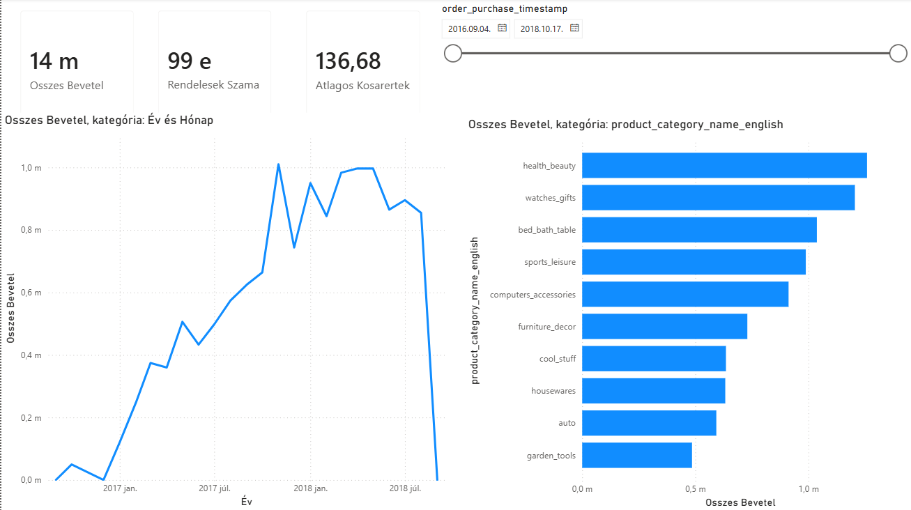
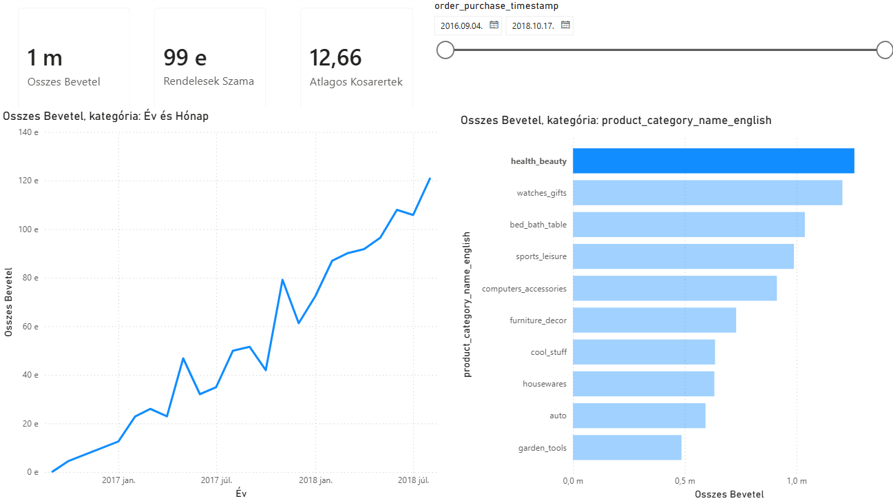

# 📊 E-Commerce Értékesítési és Vásárlói Teljesítmény Elemzés (Power BI & SQL)

## 📌 Projekt Áttekintés
Ebben a projektben egy e-kereskedelmi adathalmaz (Olist Store) 100 000 megrendelésének adatait dolgoztam fel és elemeztem. A projekt célja az alapvető üzleti KPI-ok (bevétel, kosárérték, volumentrendek) feltárása, a kiemelkedő termékkategóriák rangsorolása, valamint a szállítási logisztikai pontosság ellenőrzése volt.

---

## 🖥️ Interaktív Power BI Dashboard

### 1. Teljes Értékesítési Áttekintés

### 2. Kategóriaszűrés (Health & Beauty)

### Főbb Dashboard Elemek:
- **Vezetői KPI Kártyák:** Összesített forgalom (~14M BRL), Rendelések száma (~99 ezer), Átlagos rendelési érték (AOV: 136,68 BRL).
- **Havi eladási trend (Vonaldiagram):** A havi forgalmi dinamika és a kiugró Black Friday időszak azonosítása.
- **Top 10 Kategória (Sávdiagram):** A legnagyobb árbevételt realizáló termékcsoportok rangsorolása angol megnevezéssel.
- **Dátumválasztó szeletelő:** Tetszőleges időszakra történő dinamikus szűrés.

---

## 🛠️ Használt Technológiák és Módszertan
- **Power BI Desktop:** DAX mértékek (`SUM`, `DISTINCTCOUNT`, `DIVIDE`), Relációs adatmodellezés (1:N kapcsolatok), Power Query adattisztítás és típuskezelés.
- **SQL (PostgreSQL):** Többtáblás összekapcsolások (`JOIN`), Közös táblakifejezések (`WITH CTE`), Rangsoroló ablakfüggvények (`DENSE_RANK() OVER`), Feltételes üzleti logika (`CASE WHEN`).
- **Adatforrás:** Kaggle – *Brazilian E-Commerce Public Dataset by Olist*.

---

## 📂 Tároló Tartalma
- `olist_ecommerce_analysis.sql`: A projekt üzleti kérdéseire választ adó strukturált SQL lekérdezések.
- `portfolio.pbix`: A teljes interaktív Power BI dashboard fájl.
- `dashboard_overview.png`, `dashboard_filtered.png`: Vizuális előnézeti képek a dashboardról.
